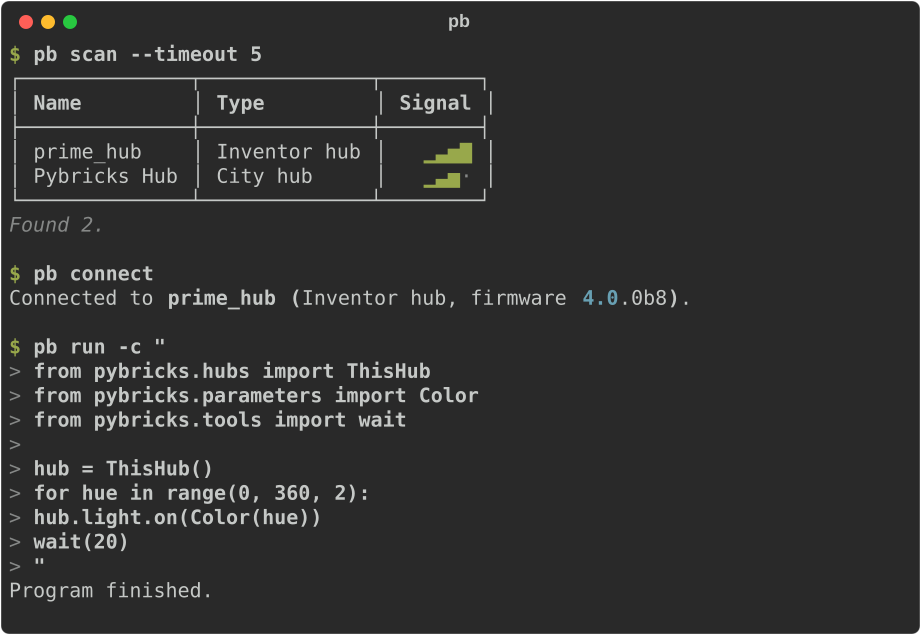

<p align="center">
  
</p>

<h1 align="center">Pybricks Tools</h1>

<p align="center">
  Run Python on your <a href="https://pybricks.com">Pybricks</a> hub,
  from your computer.
</p>

<p align="center">
  
</p>

Install it with [uv](https://docs.astral.sh/uv/getting-started/installation/):

```bash
uv tool install pybricks-cli
```

Then switch a hub on and pick it off the list:

```bash
pb connect --scan
pb run -c "
from pybricks.hubs import CityHub
from pybricks.parameters import Color
from pybricks.tools import wait

hub = CityHub()
for hue in range(0, 360, 2):
    hub.light.on(Color(hue))
    wait(20)
"
```

`CityHub` is the class for that kind of hub; use `PrimeHub`, `TechnicHub`,
`InventorHub`, `EssentialHub` or `MoveHub` for yours.

**The hub stays connected after the command finishes.** So the second `pb run`
starts instantly, and so does the hundredth — edit, run, edit, run, with no
waiting for Bluetooth in between. It also means the hub does not switch itself
off while you are thinking, the way one nothing is connected to does.

Once a program outgrows one command, put it in a file:

```bash
pb run my_robot.py
```

And the same hub is there from your own Python:

```python
async with pb_client.connect() as pb:
    await pb.connect_hub(name="Rover")
    await pb.run_program(await pb_client.compile_script(Path("my_robot.py")))
```

> **Status:** beta. Commands and APIs may still change before 1.0.0.

[Documentation](docs/index.md) · [Contributing](CONTRIBUTING.md)
